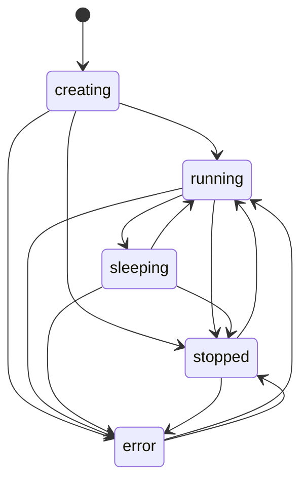

# The lifecycle

The lifecycle service owns every imp's state and is the one part of impd that starts, sleeps, wakes,
stops and destroys VMs. Every other part that needs a running guest, such as the API, the wake
proxy, the SSH gateway or a tunnel, asks the lifecycle for one.
[Sleep and wake](./sleep-and-wake.md) covers how a sleep and a wake run, and
[the RAM governor](./ram-governor.md) covers the admission every boot and wake passes.

## States

An imp is in one of five states. A transition table names the legal moves, and any other move fails
with `INVALID_STATE`. The state write checks the table itself, and it takes only a record read under
the imp's lock, so no command moves an imp past the table. A destroy works from every state and is
no transition: it removes the imp.

A create writes the imp's row as `creating`, clones its disk from the image and boots it. A create
that asks for no start, such as a move's received copy or a restored backup, goes to `stopped` once
its disk is ready. That move belongs to the create alone, so a stop refuses an imp that is still
`creating`. A create that the governor turns away deletes the row again, so a refused create leaves
nothing behind. `running` means a VM is up and its agent answered. `sleeping` means the VM is gone
and a committed memory snapshot is on disk. `stopped` means there is neither, and the next use boots
the disk cold. `error` holds an imp whose create or boot failed in a way impd could not undo, and a
start or a stop leaves it.

Anything that needs a VM wakes a sleeping imp and boots a stopped one: an exec, a console, a proxied
request, an SSH login, a tunnel, a service change, a checkpoint and a lease. A stop frees the imp's
RAM and its snapshot. It does not keep the imp off, because the next request boots it again.

## The lock

Each imp has one lifecycle lock, a FIFO queue in impd's memory keyed by the imp's ID. Every boot,
sleep, wake, stop and destroy of one imp runs under it, so two calls never change one imp's VM at
once, and a second wake that queues behind the first finds the imp running and returns. Under the
lock the caller gets the imp's record read again, as a type only the lock module can make, and the
VM operations take only that type. So no boot, sleep or wake can run without the lock. A new imp's
row is written under the lock it is created with, and nothing else reaches the imp before its create
holds it.

One state change runs outside the lock: a liveness repair. A read that finds an imp's VM dead, or
its snapshot lost, marks it stopped with a conditional update, and skips the repair while the imp's
lock is taken, so it never hides a VM that a start under the lock just booted.

The repair also records why the VM died, when impd can tell. A VM that its memory limit killed is
named as such. A VM lost after a kernel oops is named as an oops and kept off its disk until the
host reboots, because an oops keeps every hold its dead task had, and a hold on the disk's dataset
lasts until the reboot clears it. impd reads the kernel's taint flag for an oops at start and at
each repair of a lost VM. It blames the oops only after it saw the flag go from clear to set,
because a VM that ran when impd started had already outlived any earlier oops. It also blames it
only for a VM that was running when impd first read the flag set, because a VM that booted or woke
later never met the oops. An oops kills one thread and not its process, so a Firecracker can outlive
the oops that hit it and die much later. impd therefore blames the oops only on the VM whose
Firecracker owned the killed thread: it reads the thread's id from the oops header in the kernel log
and matches it against the threads the resource sampler saw in each VM. It keeps that match after
the VM leaves the sampler, so a VM lost later is judged against it. When impd cannot read the oops
from the log, or no VM owned the thread, any VM may hold the disk, so impd blames the oops on every
VM lost after it. Until the flag clears, impd refuses a start or a wake of that imp with an error
that asks for the reboot ([a kernel oops](../../guides/operations.md#a-kernel-oops)). The hold lives
in the imp's record with the kernel's boot id, so it outlasts the reboot that freed the disk. At
start impd clears every hold when it reads the flag clear, because only a reboot clears the flag. It
also clears a hold that records another boot's id, whatever the flag reads, because an oops in
another task between the reboot and impd's start sets the flag again without holding the imp. A read
that fails or finds no taint mask does not prove a reboot, so a hold of this boot stays, and impd
refuses a start or a wake of the held imp until a read finds the flag clear. A hold without a boot
id, from an impd that did not record one or could not read it, waits for a clear read too.

Background work never waits for a lock. The idle loop, the governor, the watchdog and the memory
controller try the lock and skip the imp when anything holds it or waits for it. The governor holds
its own admission lock while it sleeps imps, and a boot waiting for admission holds an imp's lock,
so a governor that waited for imp locks could deadlock with it.

The lock also gates moves. While an imp is marked as moving between hosts, the lock refuses every
call with `MOVING`, by name or by ID, except the move's own steps
([moves](../storage/moves.md#one-live-copy)). The refusal sits in the read under the lock, so no
caller depends on the order in which the move writes its mark. A background try finds a moving imp
held and skips it, and impd's start-up repair reaches a moving imp as its move does, because the
moves recover only after it. Every operation under the lock joins the storage gate too, so the
storage sweep never takes a disk that an operation is about to name
([disk space](../storage/disk-space.md#the-sweep)).

## What keeps an imp awake

impd counts the host-side connections to each imp: exec sessions, attached consoles, proxied
requests and WebSockets, SSH connections and tunnels. An exec counts its session before it asks for
the wake, so no background sleep slips in between. The idle loop adds what the guest reports: open
TCP connections and real CPU work ([idle detection](./sleep-and-wake.md#idle-detection)).

A lease keeps an imp awake on purpose. Each lease belongs to one caller, by its principal, has a
label and an end, and an acquire wakes or boots the imp. The imp's hold is the latest end of its
live leases, and the idle loop and the governor both skip a held imp. A lease taken through the
lease API also blocks a user's sleep or stop, which fails with `LEASED` unless the caller passes
`force`, and that ends the leases. The `hold` label that `impz hold` writes keeps the imp awake but
never blocks a sleep or stop. Nothing renews a lease for its holder: a holder that dies leaves its
lease to run out at its end, and deleting a token ends none of its leases.

A builder imp, which runs one image build, never sleeps in the background, because its build would
stall until a wake.

## The watchdog

The idle loop asks every running agent for its activity, and the watchdog counts the answers. An
agent silent past the watchdog's timeout gets one longer ping. A silence that outlasts it is
reported in the log and in each imp's listing, and an answer or a lifecycle operation on the imp
clears it. What happens next is the owner's choice. The default only reports, because the proxy
reaches the guest's servers without the agent, so a deaf agent can still serve. A restart kills the
VM and boots the disk cold, and a snapshot first keeps the VM's memory for a post-mortem. A recovery
takes the imp's lock with a try, as a background sleep does, and the recoveries back off and stop
after a few in an hour, so a guest that hangs on every boot does not loop.

## Stop and destroy

A stop asks the agent to shut the guest down, kills Firecracker if it outlives a grace period,
removes the imp's cgroup and drops its snapshot. A destroy kills the VM, then removes the cgroup,
the jail, the tap, the slot and the files, and deletes the row last. So a destroy that a crash cuts
short leaves a row that names what is left, and the next destroy finishes it.

## impd's own stop

impd closes a shutdown gate before it stops, and after that no VM boots or wakes: those calls fail
with `SERVICE_UNAVAILABLE`, and a create cut short goes to `error`. Two signals decide what happens
to the VMs:

- **SIGTERM or SIGINT** sleeps every awake imp, so a container restart keeps every imp's memory. The
  pass covers sleeping and stopped imps too, since one may be waking or booting under its lock, and
  it runs them together, bounded by the host's sleep slots.
- **SIGHUP** sleeps nothing. It waits for the wakes and boots under way, so none leaves a
  Firecracker that no record names, and exits with every VM running.

The whole stop runs against one deadline. If the sleep pass runs out of it, impd exits without
closing the database, since a sleep may still be writing to it.

## Recovery after a restart

The locks, the governor's reservations and every counter are in memory, so a new impd starts from
the database and the processes it finds. Firecracker runs detached, and impd finds each VM by the
API socket in its argv and its pid file. A jailed process can put any socket in its argv, so impd
takes a process as an imp's VM only when it runs as that imp's jail uid, as root for an unjailed VM,
or in that imp's cgroup. A jail can change none of those, so it cannot get another imp's VM killed
or its snapshot dropped.

impd then settles each imp under its lock:

- A VM that no record owns is killed: a second VM on one imp's socket, a VM on a stopped imp's
  socket, or a VM of an imp with no row.
- A running imp with a live VM is adopted as it is. One whose sleep was cut short left its VM
  paused, and impd resumes it.
- A running imp with no live VM is marked `stopped`, and its next use boots cold. The exception is
  an imp whose snapshot is newer than the last activity on its row: impd died between the snapshot's
  commit and the row's update, so the imp is marked `sleeping` and keeps its memory.
- A wake cut short is settled from its snapshot's state ([wake](./sleep-and-wake.md#wake)).
- A `creating` imp goes to `error`, and its VM is killed.
- Half-written snapshot and identity files go, and so do the jails and cgroups of imps that no
  longer exist.

A VM that will not die never keeps impd from starting: impd logs it and goes on. Where it is a
running or creating imp's own VM, the record keeps its pid, so the next start or destroy kills it
again. Sleeping imps stay asleep, and each wakes on its next request.
