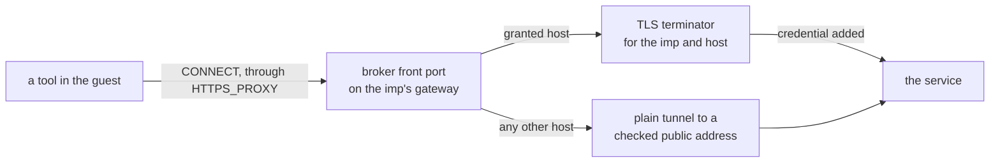

# The credential broker

A coding agent in an imp needs API tokens, and a token the guest holds can be read and sent anywhere
by whatever runs there. The broker keeps the tokens on the host instead. The owner grants a secret
to an imp, and the broker adds it to the imp's requests to that secret's hosts, so the guest, its
disk, its snapshots, its checkpoints and its forks hold only a placeholder. The
[connectors guide](../../guides/connectors.md) covers secrets, grants and their kinds.

## The path of a request

Each guest reaches the broker on its own gateway, the one port of the host container a guest may
reach besides the resolver's ([networking](./networking.md#the-base-firewall)). The broker takes
only `CONNECT`, and names the imp from the connection's two ends; the reverse-path check on the taps
keeps a guest from sending with another imp's address, so that name holds. A connection to a host
the imp has a grant for goes into a TLS terminator for that imp and host, a Bun server on a unix
socket in the data directory, with a leaf certificate from the broker's own CA. The guest trusts
that CA, because impd writes it into the guest's trust bundle. The terminator reads the grant, the
rule and the value for each request as it arrives, not when the connection opens, so a revoke takes
effect on the next request, and an audit row records each request it sent with a credential. A grant
may carry a method and path filter, read with the grant, and the terminator refuses a request
outside it before the credential goes into any header
([narrow a grant](../../guides/connectors.md#narrow-a-grant)). The front port and the terminator
also record each request they refuse, with the imp, the reason and the host when the request names
one. Both refuse before they add any credential, so a refused row never holds one.

Any other host gets a plain tunnel. A tunnel starts inside the host container, past the firewall
that holds the guests in, so the broker refuses it every private, shared, loopback and link-local
range, the blocked IPv6 ranges, and the container's own addresses, and holds a tunnel to the imp's
egress policy ([egress](./egress.md)). A host a grant covers stays reachable under every policy,
because the terminator dials it from the host container.

## Secrets

The values live in the data directory, one file each, readable by root only, and the database keeps
only the names, the hosts and the grants with their filters. No backup and no move carries a value:
a restore and a move bring each grant back, with its filter, only where a secret of that name exists
on the new host. A filtered grant travels apart from the others, so an impd that knows no filters
drops it rather than grant the whole host. An OAuth secret holds a refresh token, and impd exchanges
it for access tokens from the host before each expires, so the guest only ever holds the
placeholder. A secret can also name an upstream for a host with no public name, such as a service on
the owner's machine, and the guest then names a made-up host that only the broker resolves.

An imp may hold one credential per host, so two grants that cover the same host conflict, and impd
checks the clash and writes the grant in one transaction. A fork copies its source's grants with
their filters, as far as the forking caller could make them itself
([auth](../control/auth.md#scopes)).

## Who gets the proxy

An exec in an imp with a grant gets the proxy and CA variables once impd has written the CA bundle
into this boot of the guest, and an exec can require that before it starts, which fails rather than
run without the broker. Services started from the image's service files get none of it. A tool that
ignores `HTTPS_PROXY`, or keeps a trust store of its own, goes around the broker and gets no
credential. A ticker stops terminators that no grant covers and renews their leaf certificates.
