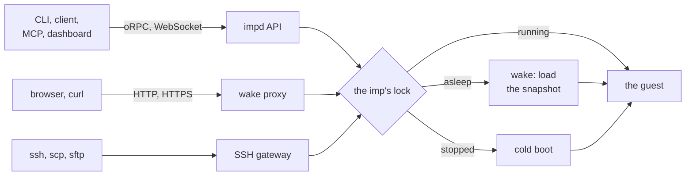
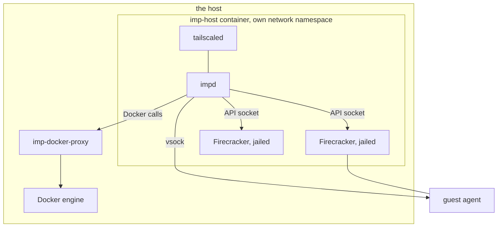

# Architecture overview

An imp is a persistent Linux microVM that sleeps when it is idle and wakes on the next request to
it. A sleeping imp holds no RAM: its memory is a snapshot on disk, and a wake loads it back with
every process where it was. Its disk is a copy-on-write clone, so a checkpoint, a restore or a fork
costs no copy. One host runs every imp, and one daemon, impd, owns them all. impd keeps every awake
imp under a RAM budget the owner sets, and sleeps the least recently active ones to make room.

The code is one Bun workspace and one Go module. impd is `packages/daemon`. Its typed contract,
`packages/api`, is shared with the CLI, the npm client, the MCP server and the dashboard. Helpers
that know nothing about imps, such as byte and duration formats, live in `packages/shared`, which
imports no other workspace package and no Node module, so the dashboard and the published client can
bundle it. The guest agent is `agent/`.

## The path of a request

Every way into an imp passes impd, and every path that needs the guest wakes it first.

A control call, such as a create or a checkpoint, is an oRPC procedure. The API checks the caller's
credential and scope before it runs the handler ([auth](./control/auth.md)). A command or a shell in
the guest is a WebSocket that impd bridges to the guest agent ([the API](./control/api.md)). The
wake proxy takes HTTP for an imp by its host name or by its own port, and forwards it to the guest's
HTTP port ([ingress](./network/ingress.md)). The SSH gateway runs inside impd and turns each login
into an agent exec. Each of these first asks the imp's lifecycle for a running VM. The lifecycle
takes the imp's lock, wakes or boots it, and hands back the VM, so two requests that reach a
sleeping imp at once cause one wake ([the lifecycle](./lifecycle/lifecycle.md)).

impd reaches the guest agent over vsock, never over the guest's network. The agent runs each command
in an inner container whose root is the user's disk ([the agent](./guest/agent.md)). Traffic for the
guest's own servers takes the network instead: the proxy connects to the guest's address, and a
tunnel or an SSH forward dials through the agent from inside the guest.

## Topology

The host under impz is thin: it gives KVM, cgroup v2, Docker and a filesystem for the data, and runs
two containers from one image ([the host](./host.md)). The imp-host container holds impd, every
Firecracker process and the tailnet node, in a network namespace of its own, so the taps, routes and
firewall rules for the imps never touch the host's network. A small entrypoint sets up the cgroups,
the storage, the network and Tailscale, then runs impd under a supervisor that restarts it. The
second container, imp-docker-proxy, holds the host's Docker socket and lets through only the calls
impd makes, for image pulls and builds.

impd is one Bun process. It starts one Firecracker microVM per awake imp, detached from itself, so
an impd restart leaves every VM running and the next impd adopts them. Each Firecracker runs under
its jailer as the imp's own uid, in its own chroot and cgroup ([isolation](./isolation.md)). A guest
boots a kernel impz builds, from a read-only system drive that holds the agent, so any OCI image
boots with nothing of impz in it.

Reach comes from the tailnet. The host publishes impd's ports on its loopback only, and tailnet
traffic arrives inside the container's namespace through its own tailscaled. Nothing on the host
needs an inbound port, and a public imp is the one opt-in exception
([ingress](./network/ingress.md)).

## The data

All of impd's state lives in one data directory.

- **The database.** One SQLite file, through Kysely on `bun:sqlite`, in WAL mode with a single
  connection. It holds the imps, checkpoints, images, tokens, grants, networks, leases, moves and
  the audit rows. Its migrations live in code. Only the daemon's database module builds queries;
  every other module reads and writes through its repositories, and an imp write goes out on a write
  feed that the module takes when it opens the file.
- **Each imp's directory.** The disk, the memory snapshot of a sleeping imp, the record of what its
  VM booted with, the Firecracker sockets and the session logs. A disk is a reflink clone on XFS or
  a dataset on ZFS ([storage](./storage/storage.md)).
- **Images and templates.** Each OCI image as one ext4 file, the shared parent of every disk made
  from it ([images](./storage/images.md)), and the snapshots of parked guests that cold boots
  restore ([boot templates](./lifecycle/boot-templates.md)).
- **Secrets and keys.** The root token, the credential broker's values and CA, the SSH host key and
  the TLS certificate, each a file only root reads. No backup holds them
  ([backups](./storage/backups.md)).

The disk is the truth about an imp, and a memory snapshot only ever wakes on the disk it was made
with. Anything that changes the disk behind a snapshot, such as a restore, drops the snapshot first,
and the imp boots cold.

## Cross-cutting rules

- **One lock per imp.** Every lifecycle change of one imp runs under that imp's lock, and every
  background job only tries it. The locks live in impd's memory, and a restart rebuilds what they
  guarded from the database and the processes it finds
  ([the lifecycle](./lifecycle/lifecycle.md#recovery-after-a-restart)).
- **Two budgets.** The RAM governor admits every boot, wake and memory grow, and sleeps imps to make
  room ([the RAM governor](./lifecycle/ram-governor.md)). The disk budget holds back a reserve of
  free space that no write may take ([disk space](./storage/disk-space.md)).
- **The guest is not trusted.** impd checks everything an agent reports before it uses it, a guest
  reaches the host container only on the broker's and the resolver's ports, and a jailed VM can
  touch no files but its own ([isolation](./isolation.md)).
- **Events.** Every write to an imp or checkpoint row becomes an event on one in-process bus, in
  write order. The event stream, the proxy, the broker and the telemetry read it
  ([the API](./control/api.md#events-audit-and-telemetry)).
- **Import direction.** The packages form a stack: the leaves at the bottom, then the API contract,
  the published client, the MCP server, and the three apps (the CLI, the dashboard and impd) on top.
  oxlint refuses an import that points up the stack or across to another app, type-only imports
  included, so the order cannot drift. It also refuses a Node import in the contract or the client,
  because the client runs in browsers and in Node alike; a query builder outside the daemon's
  database module; and production code that imports test support.
- **More than one host.** Each host is its own impd with its own data. A move takes an imp from one
  to another over the tailnet, with marks on both copies that keep exactly one live
  ([moves](./storage/moves.md)).

## The docs

- `lifecycle/`: [the lifecycle](./lifecycle/lifecycle.md),
  [sleep and wake](./lifecycle/sleep-and-wake.md), [the RAM governor](./lifecycle/ram-governor.md),
  [elastic memory](./lifecycle/elastic-memory.md) and
  [boot templates](./lifecycle/boot-templates.md).
- `guest/`: [the guest agent](./guest/agent.md), [the agent protocol](./guest/protocol.md) and
  [sessions](./guest/sessions.md).
- `storage/`: [storage](./storage/storage.md), [disk space](./storage/disk-space.md),
  [images](./storage/images.md), [backups](./storage/backups.md) and [moves](./storage/moves.md).
- `network/`: [networking](./network/networking.md), [egress](./network/egress.md),
  [ingress](./network/ingress.md) and [the credential broker](./network/broker.md).
- `control/`: [the API](./control/api.md) and [auth](./control/auth.md).
- [Isolation](./isolation.md) and [the host](./host.md) cover the boundaries around every imp.
