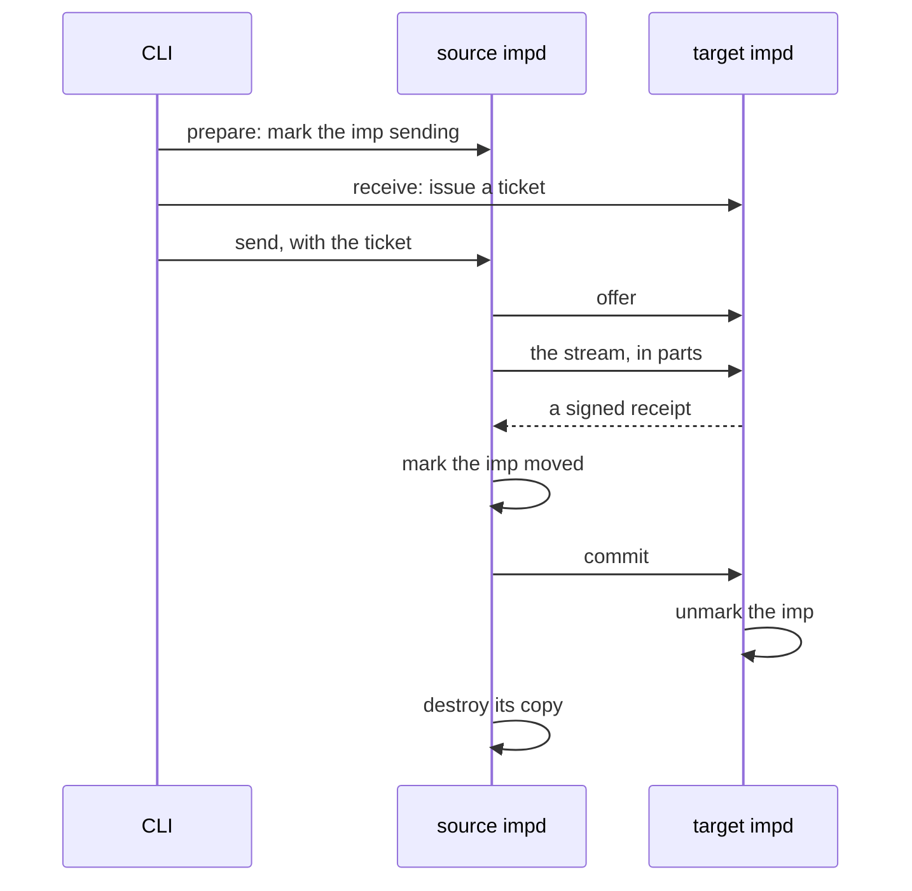

# Moves

A move takes an imp from one host's impd to another's over the tailnet. A stopped imp moves cold and
boots cold on the target. A sleeping imp moves warm, with its memory, between hosts that can load
it. A running imp moves only once it is stopped or asleep. The
[hosts guide](../../guides/hosts.md#moves) covers what a move keeps and how to run one. This doc
covers the protocol in `moves/`.

## The steps

The CLI makes the first three calls, each with that host's own saved token, so the two impds never
share a token. A receive takes in an image and grants, which are host-wide, so it needs `manage`
scope on the whole target. The source then talks to the target on routes that take no token: the
ticket is their only credential, and the target answers them only for a peer on the tailnet, judged
by the connected socket's address, never by a header or a lookup.

The offer tells the source whether the target needs the image and what it can keep: an elastic imp's
max memory, the imp's leases, and the `public` egress policy. The source refuses to send an imp that
the target would land with less, before the stream, and starts again an imp its prepare stopped. A
warm move of an imp on a private network is refused, since its peers stay behind.

## The stream

The stream carries a header, then each file as frames of its data blocks with a hash at its end: the
image when the target asked for it, each checkpoint oldest first, then the disk, and for a warm move
the memory snapshot. Only the blocks that hold data cross the network, so a sparse disk's holes
never do. The target writes each checkpoint over the imp's disk block by block and checkpoints it,
so the checkpoints share every block they shared on the source. The stream goes as a series of
bounded POSTs, so no request body ever has to fit a whole disk, and the target counts the bytes
against the ticket and checks each file's hash.

The header carries the imp's settings, its grants by secret name, its leases with the time each has
left, and its last cold boots, so a session client from before the move learns that the next boot
ended its output ([sessions](../guest/sessions.md#generations-boots-and-offsets)). The target ends
each lease that long after its own clock read the header, so clock skew between the hosts has no
effect. The target makes a grant only for a secret it has by that name, and gives the imp a jail uid
of its own.

## One live copy

A move keeps exactly one copy live. Both copies exist from the stream until the commit, and neither
may run.

| Source    | Target               | Who may wake the imp                          |
| --------- | -------------------- | --------------------------------------------- |
| `sending` | none, or `receiving` | Nobody. An abort takes the source's mark off. |
| `moved`   | `receiving`          | Nobody. A commit or an abort ends it.         |
| gone      | none                 | The target.                                   |

A marked imp's lock refuses every call by name with `MOVING`, except the move's own steps, so no
start, wake, stop, fork, checkpoint or restore runs, and its egress policy and grants refuse
changes, since the header carries the ones the send read. The marked imp keeps its row, so the
storage sweep keeps every file the send reads.

The source marks the imp `moved` only once it has checked the receipt: a MAC over the files' hashes,
keyed with the ticket's secret, which only the two hosts know. So a receipt that checks came from
the target, which holds every byte. The commit is idempotent: a target that committed answers a
second commit, and an abort, with the fact that it committed, and the source destroys its copy on
that answer, wherever it comes from. On the target, the commit and the abort run under the imp's
lock, so they never cross, and the commit takes the mark off and spends the ticket in one
transaction.

Tickets have windows: one to start the stream, one between parts, and one for the commit. The target
stores only the ticket's hash, and the source keeps the whole ticket, since it needs the secret
again to check the receipt and, after a restart, to commit or abort. A reissue gives a new ticket
for a commit whose window ran out.

## Recovery

A crash on either side leaves marks that say where the move stood. At start the source aborts a
`sending` imp at the target and takes its mark off once the target confirms, and retries the commit
of a `moved` one, in the background. The target settles its side before it serves the API: it
removes a staged imp whose stream has no receipt, deletes unused tickets past their window, and
clears its stream files. A staged imp with a receipt stays until the source commits or aborts it.

## Warm moves

A warm move puts the imp into the same slot on the target, because the snapshot holds the slot's
tap, addresses and MAC, and each tap's MAC comes from its slot, so the guest's neighbour entry for
its gateway holds ([networking](../network/networking.md#addressing)). The ticket keeps the slot for
the imp while its stream runs. The snapshot's facts, the CPU, the host kernel and the Firecracker
version, are checked against the target three times: at the prepare, at the receive and in the
header, and last by the wake's own check, so a snapshot that got past the others still boots cold
and never faults ([snapshot identity](../lifecycle/sleep-and-wake.md#snapshot-identity)). The
snapshot's record goes last, and the commit sets the imp `sleeping` only once it reads whole.

A warm move trusts the source with the target host, not only with the imp. The VM state is
Firecracker's own format, which the target does not parse, and the paths in it are what the target's
Firecracker opens at the load. The jailer keeps that load to the imp's own chroot and uid; without
it the load has impd's rights. So warm moves run only between hosts that trust each other.

## ZFS

Between two ZFS hosts, the disk and checkpoints go as `zfs send` streams instead of files. An imp's
snapshots do not sit in one line, because a restore retires the old disk and clones a checkpoint in
its place, so they spread over datasets linked by origins, which a recursive send cannot follow. The
source sends them in the order ZFS made them, each incremental from an earlier one on its dataset,
from its dataset's origin when that is in the set, or else in full. The header names each stream's
base by number, never a dataset name, and the target names each snapshot itself. A forked disk's
first stream is full, so no other imp's data goes along.

`zfs recv` commits when it reads a stream's end, not when its input closes, so the target holds back
each stream's last frame until its hash matches, and a stream that fails its hash never reaches the
pool whole. Every other pair of backends sends files: a ZFS source mounts read-only clones of its
snapshots, as a backup does, and a ZFS target writes files over an empty disk dataset.
